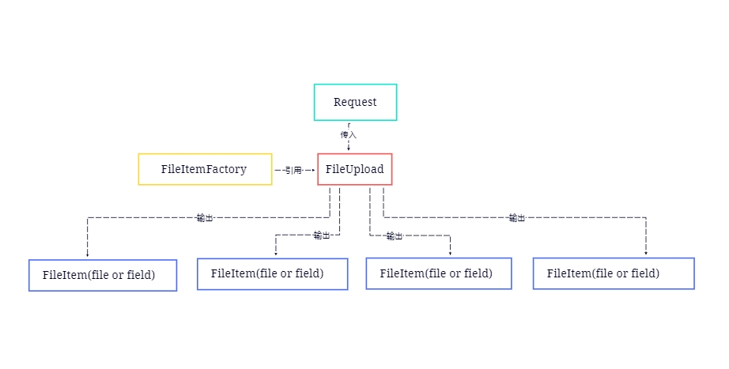

<div align="center">
<h1>upload4cj</h1>
</div>

<p align="center">


</p>

##  介绍

upload4cj是用于处理浏览器或者其他客户端上传上来的单个或者多个文件的一个文件报文解析组件(注:这里的文件指字段和文件两部分)

参考了apache的commons-fileupload

参考地址：https://github.com/apache/commons-fileupload 版本 1.5

**特性**：

- 🚀 支持解析单个字段或者多个字段上传上来的报文

- 💪 支持解析单个文件或者多个文件上传上来的报文

- 🌍 支持解析字段和文件一起上传上来的报文

##  架构

### 架构图



### 源码目录

```shell
.
├── doc
├── src
│   ├── upload4cj
│            ├──deferredFile_output_stream.cj
│            ├──disk_file_item_factory.cj
│            ├──disk_file_item.cj
│            ├──file_item_factory.cj
│            ├──file_item_headers_impl.cj
│            ├──file_item_headers_support.cj
│            ├──file_item_headers.cj
│            ├──file_item_iterator_impl.cj
│            ├──file_item_iterator.cj
│            ├──file_item_stream_impl.cj
│            ├──file_item_stream.cj
│            ├──file_item.cj
│            ├──file_upload_base.cj
│            ├──file_upload_exception.cj
│            ├──file_upload.cj
│            ├──inter_input_stream.cj
│            ├──item_input_stream.cj
│            ├──limited_input_stream_impl.cj
│            ├──limited_input_stream.cj
│            ├──mime_utility.cj
│            ├──multipart_stream.cj
│            ├──parameter_parser.cj
│            ├──progress_listener.cj
│            ├──progress_notifier.cj
│            ├──quoted_printable_decoder.cj
│            ├──request_context.cj
│            ├──servlet_file_upload.cj
│            ├──servlet_request_context.cj
│            ├──streams.cj
│            └──thresholding_output_stream.cj
└── test
│   ├── DOC
│   ├── FUZZ
│   ├── HLT
│   └── LLT
├── CHANGELOG.md
├── gitee_gate.cfg
├── LICENSE.txt
├── module.json
├── README.md
├── README.OpenSource
```

- `doc` 存放库的feature_api文档
- `src` 是库源码目录
- `test` 存放 DOC 测试用例、FUZZ 测试用例 HLT 测试用例、LLT 自测用例

### 接口说明

主要核心类和全局函数说明,详情见 [API](./doc/feature_api.md)

##  使用说明

### 编译

Linux编译

(1). upload4cj 依赖 uuid4cj，请下载指定uuid4cj版本到 upload4cj的根目录进行编译，编译方式参考各自库的编译方式,地址

https://gitee.com/HW-PLLab/uuid4cj

```
cd upload4cj
git clone https://gitee.com/HW-PLLab/uuid4cj.git
```

(2). 编译upload4cj

```
cd upload4cj
cjpm build -V

```

Windows编译

(1). upload4cj 依赖 uuid4cj，请下载指定uuid4cj版本到 upload4cj的根目录进行编译，编译方式参考各自库的编译方式,地址

https://gitee.com/HW-PLLab/uuid4cj

```
cd upload4cj
git clone https://gitee.com/HW-PLLab/uuid4cj.git
```

(2). 编译upload4cj

```
cd upload4cj
cjpm build -V

```

### 功能示例

#### 通过parseRequest解析请求报文获取fileItem

```cangjie
from upload4cj import upload4cj.*
from net import http.*
from std import io.*
from std import collection.*
from std import unittest.*
from std import unittest.testmacro.*

main() {
    let ccc = Test_ReadMe()
    ccc.execute()
    ccc.printResult()
    0
}

@Test
public class Test_ReadMe{

    let CONTENT_TYPE: String = "multipart/form-data; boundary=---1234"

    @TestCase
    func test_readme_01 () {
      let text =
            "-----1234\r\n" +
            "content-disposition: form-data; name=\"field1\"\r\n" +
            "\r\n" +
            "Joe Blow\r\n" +
            "-----1234\r\n" +
            "content-disposition: form-data; name=\"pics\"\r\n" +
            "Content-type: multipart/mixed, boundary=---9876\r\n" +
            "\r\n" +
            "-----9876\r\n" +
            "Content-disposition: attachment; filename=\"file1.txt\"\r\n" +
            "Content-Type: text/plain\r\n" +
            "\r\n" +
            "... contents of file1.txt ...\r\n" +
            "-----9876--\r\n" +
            "-----1234--\r\n"

        let bytes: Array<UInt8> = text.toUtf8Array()
        var output = ByteArrayStream()
        output.write(bytes)
        var req1 = HttpRequestBuilder().method("POST").url("http://127.0.0.1/")
                   .body(output).build()
        req1.headers.add("Content-Type", CONTENT_TYPE)
        let fileItemFactory: DiskFileItemFactory = DiskFileItemFactory()
        let upload: ServletFileUpload = ServletFileUpload(fileItemFactory)
        let fileItems: ArrayList<FileItem> = upload.parseRequest(req1).getOrThrow()
        let field: FileItem = fileItems.get(0).getOrThrow()
        @Assert(field.getFieldName(),"field1")
        @Assert(field.isGetFormField(),true)
        @Assert(field.getString(),"Joe Blow")
    }
}

```
执行结果如下：

```
[ PASSED ] CASE: test_readme_01
```

#### 通过parseParameterMap解析请求报文获取fileItem

```cangjie
from upload4cj import upload4cj.*
from net import http.*
from std import io.*
from std import collection.*
from std import unittest.*
from std import unittest.testmacro.*

main() {
    let ccc = Test_ReadMe()
    ccc.execute()
    ccc.printResult()
    0
}

@Test
public class Test_ReadMe{

    let CONTENT_TYPE: String = "multipart/form-data; boundary=---1234"

    @TestCase
    func test_readme_02 () {
      let text =
            "-----1234\r\n" +
            "Content-Disposition: form-data; name=\"file\"; filename=\"foo.tab\"\r\n" +
            "Content-Type: text/whatever\r\n" +
            "\r\n" +
            "This is the content of the file\n" +
            "\r\n" +
            "-----1234\r\n" +
            "Content-Disposition: form-data; name=\"field\"\r\n" +
            "\r\n" +
            "fieldValue\r\n" +
            "-----1234\r\n" +
            "Content-Disposition: form-data; name=\"multi\"\r\n" +
            "\r\n" +
            "value1\r\n" +
            "-----1234\r\n" +
            "Content-Disposition: form-data; name=\"multi\"\r\n" +
            "\r\n" +
            "value2\r\n" +
            "-----1234--\r\n"

        let bytes: Array<UInt8> = text.toUtf8Array()
        var output = ByteArrayStream()
        output.write(bytes)
        var req1 = HttpRequestBuilder().method("POST").url("http://127.0.0.1/")
                   .body(output).build()
        req1.headers.add("Content-Type", CONTENT_TYPE)
        let upload: ServletFileUpload = ServletFileUpload(DiskFileItemFactory())
        let mappedParameters: Map<String, ArrayList<FileItem>> = upload.parseParameterMap(req1)
        @Assert(mappedParameters.contains("file"),true)
        @Assert(mappedParameters.get("file").getOrThrow().size,1)
        @Assert(mappedParameters.contains("field"),true)
        @Assert(mappedParameters.get("field").getOrThrow().size,1)
        @Assert(mappedParameters.contains("multi"),true)
        @Assert(mappedParameters.get("multi").getOrThrow().size,2)
    }

}


```
执行结果如下：

```
[ PASSED ] CASE: test_readme_02
```

## 开源协议

```
This code is under the Apache Licence v2. https://www.apache.org/licenses/LICENSE-2.0
```

## 参与贡献

欢迎给我们提交 PR，欢迎给我们提交 issue，欢迎参与任何形式的贡献。
